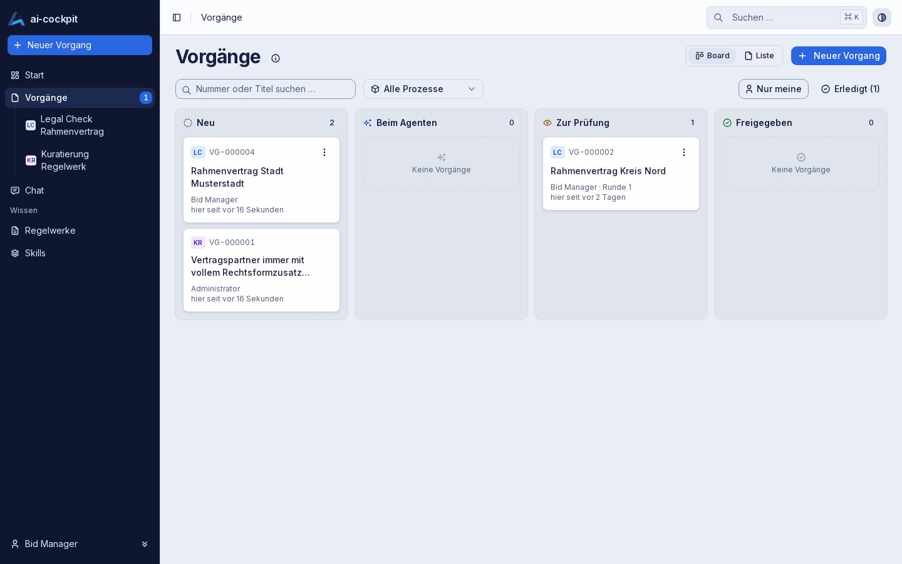

# ai-cockpit — product site

The public site of **ai-cockpit**, the AVENDIS platform for AI-assisted business processes with
human approval and a complete audit trail.

**Live:** https://avendis-gmbh.github.io/ai-cockpit-site/



## Pages

| Page | File | Content |
|---|---|---|
| Overview | `index.html` | What ai-cockpit is, the four differentiators, how it works, the first process |
| Platform | `platform.html` | Concept model, principles, architecture, what the platform is not |
| Features | `features.html` | What the application does today, each block with a screenshot |
| Use cases | `use-cases.html` | The processes that run, and what the same pattern fits |
| Roadmap | `roadmap.html` | The three stages |
| Privacy | `privacy.html` | What the site does with visitors' data |
| Not found | `404.html` | Shown by GitHub Pages for unknown addresses |

Contact and legal notice link to [avendis.com](https://avendis.com/).

## How it is built

Plain HTML and CSS. No framework, no build step, no dependencies.

```
index.html, platform.html, …    one file per page
assets/styles.css                the only stylesheet
assets/site.js                   the menu on small screens
assets/logo.png                  the AVENDIS mark
assets/img/                      screenshots of the application
```

The site loads nothing from another host: no fonts, no scripts, no analytics.

## Preview

Open `index.html` in a browser, or serve the folder:

```bash
python3 -m http.server 8080
```

Then open http://localhost:8080.

## Publishing

GitHub Pages serves the branch `main` from the repository root
(Settings → Pages → Source: *Deploy from a branch*, `main`, `/ (root)`).

**Every push to `main` goes live.** `.nojekyll` tells GitHub to serve the files as they are.

## Editing

**A new page**

1. Copy an existing page; header and footer are repeated in every file.
2. Add the page to the `nav` of every page.

**Content rules**

- Every statement holds for the application as it is today.
- What runs is tagged *Available*, what the pattern would fit *Fits the pattern*, plans *Next* or
  *Later*.
- No dates, no customer names, no figures that were not measured.

**Screenshots**

They show the clean demo state at 1440 × 900 and are reduced to 256 colours (about 30–65 KB
each). The application's interface is German.

## Licence

© 2026 AVENDIS GmbH. All rights reserved.
